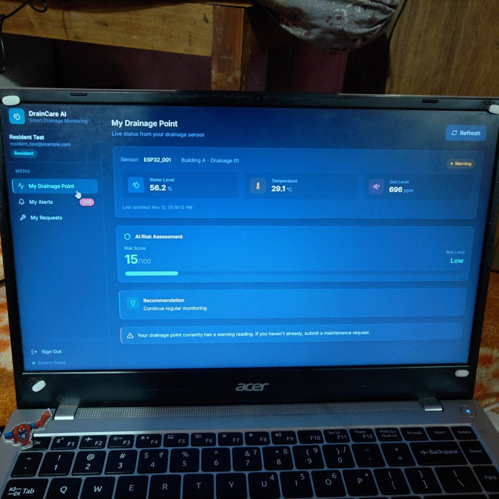
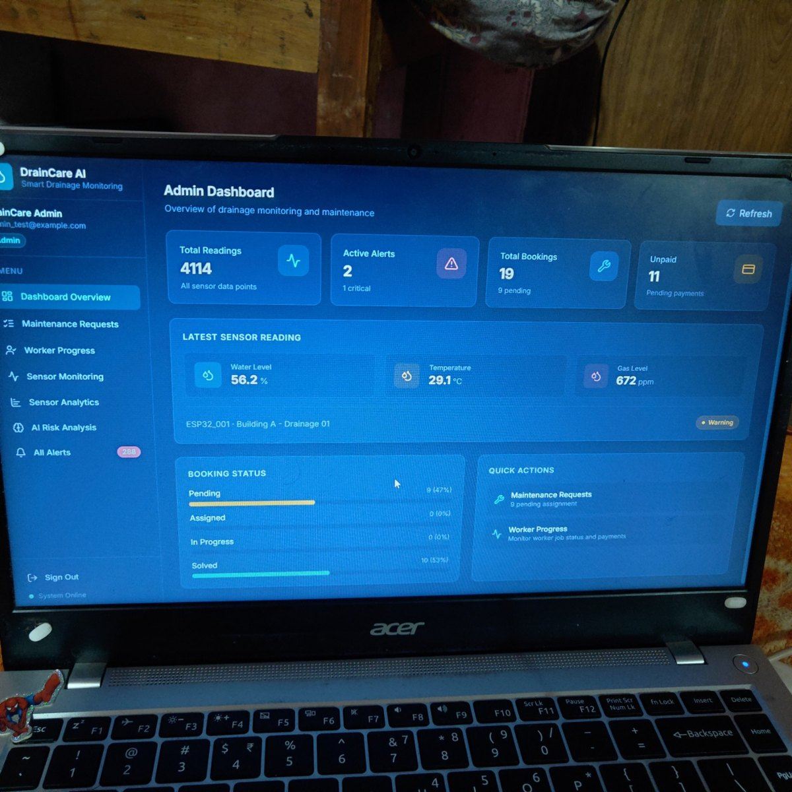
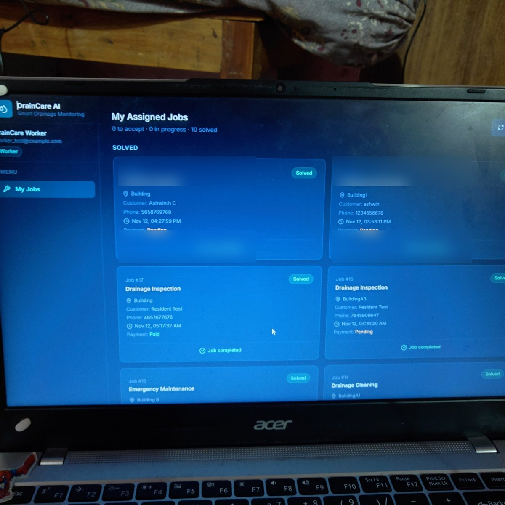
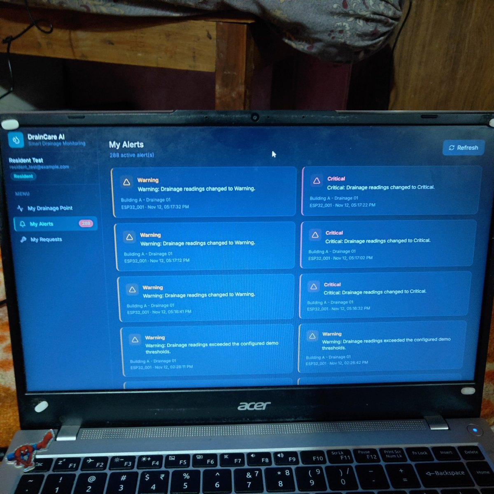
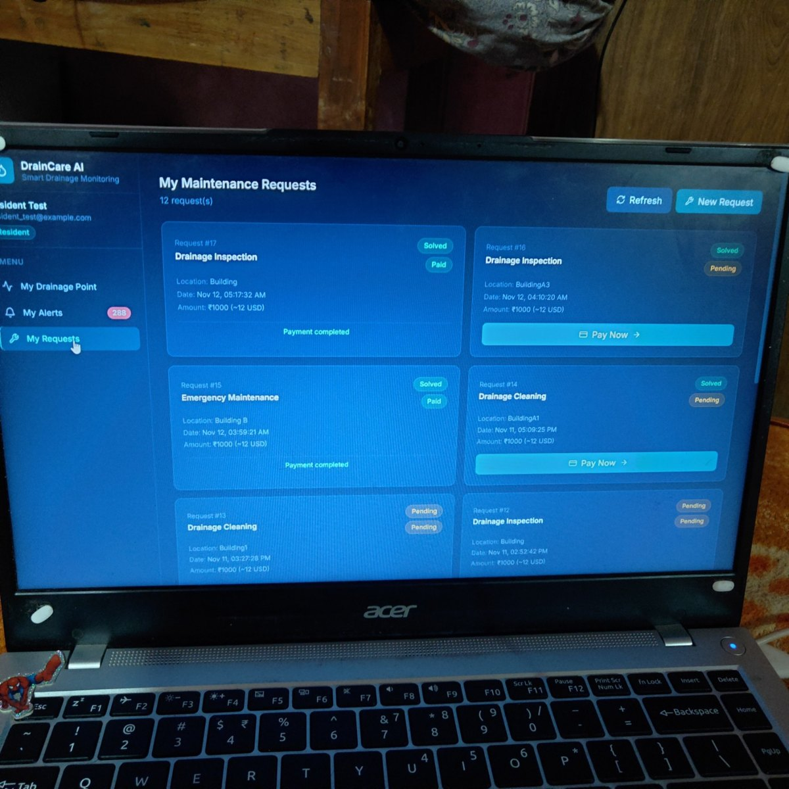
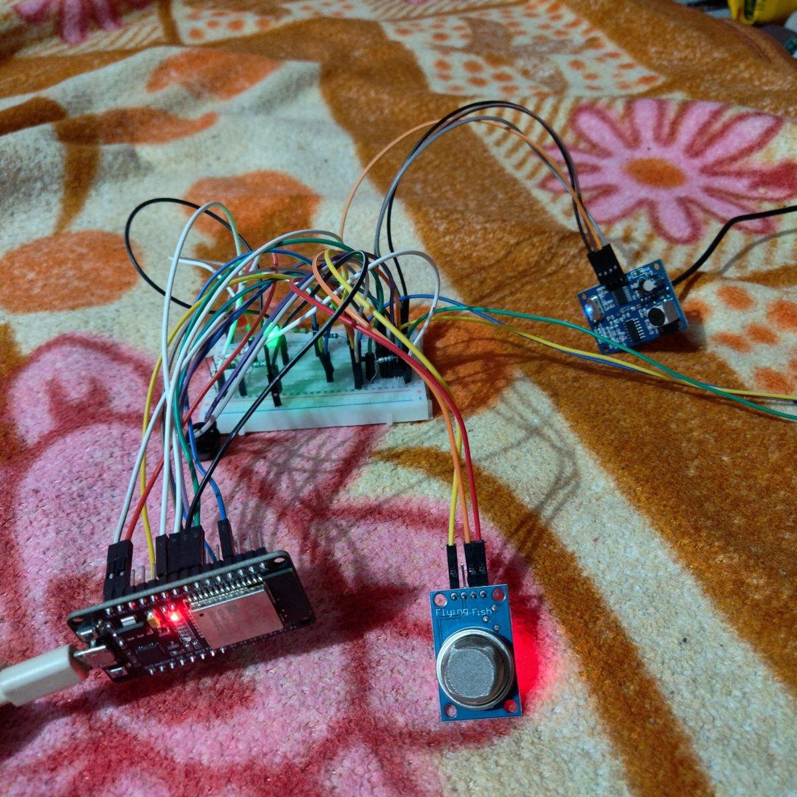
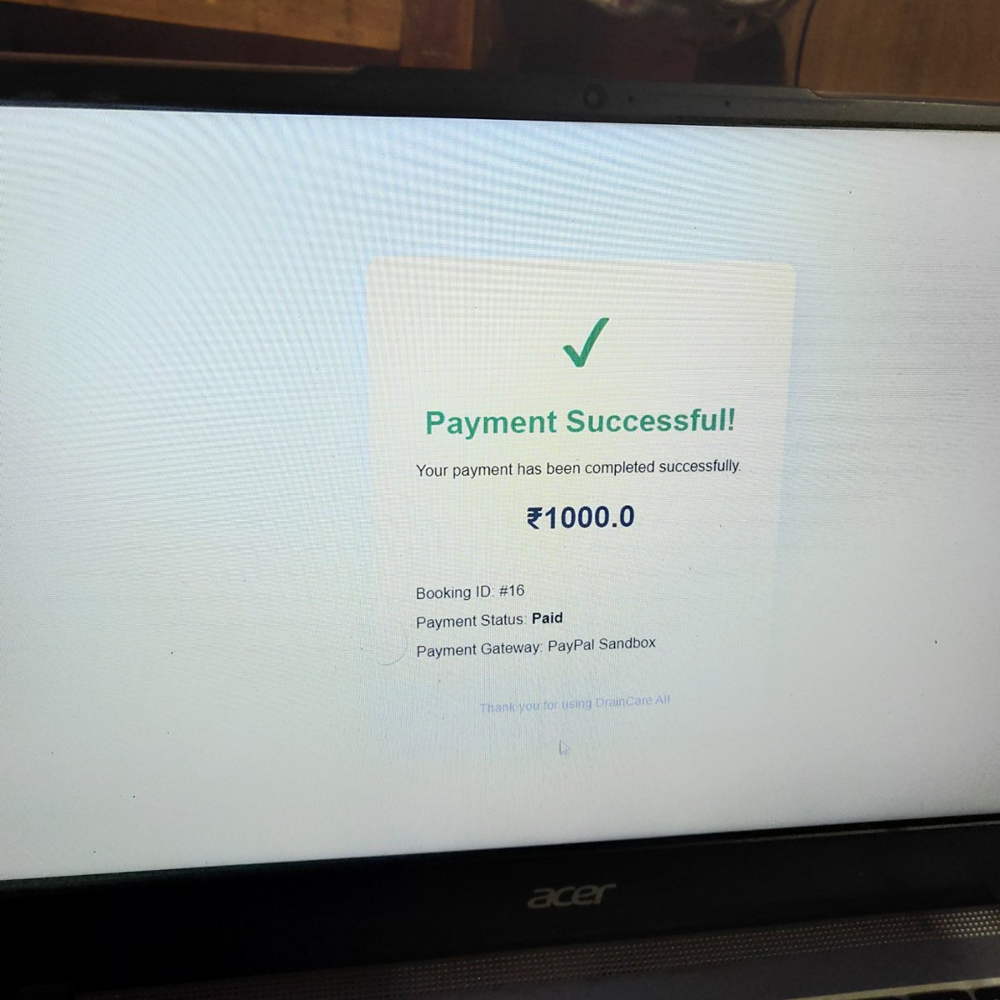

# DrainCare AI 🚰
### AI-Assisted Smart Drainage Monitoring & Maintenance Coordination

**From periodic manual checks to sensor-driven drainage risk awareness.**

DrainCare AI is a smart drainage monitoring prototype that collects water-level, temperature, and gas readings, evaluates the incoming measurements, and presents drainage conditions through a role-based web application. It is designed to help identify abnormal conditions earlier and make it easier to coordinate follow-up maintenance.

> **Project status:** Working hackathon prototype. Sensor thresholds and risk scoring are configured for demonstration and need field calibration and validation before real-world deployment.

---

## The problem

Drainage issues can develop between manual inspections. Rising water levels may indicate a blockage or overflow risk, while gas readings can indicate potentially hazardous conditions. When information is collected only during occasional visits, residents and maintenance teams may not have a timely picture of changing conditions.

DrainCare AI addresses this gap by connecting sensor readings, risk classification, alerts, and maintenance workflows in one prototype.

## Our solution

An ESP32-based monitoring unit collects readings from connected sensors and sends them over Wi-Fi to a Python backend. The backend stores the readings, evaluates configured risk conditions, and makes the latest status and alerts available to the web dashboard.

The application supports three roles:

- **Resident:** view the assigned drainage point, current readings, alerts, and maintenance requests.
- **Worker:** view assigned maintenance jobs and their progress.
- **Administrator:** monitor sensor activity, review alerts, and oversee maintenance requests and worker progress.

## What makes DrainCare AI distinctive?

The key idea is not just displaying sensor values. DrainCare AI brings together four parts of a drainage response workflow:

1. **Multi-sensor monitoring** — considers water level, temperature, and gas readings together rather than relying on one measurement.
2. **Risk classification and explanation** — converts readings into Normal, Warning, or Critical conditions and provides a risk assessment/recommendation.
3. **Status-change alert history** — records changes in risk state so users can review how a drainage condition evolves, rather than seeing only the latest reading.
4. **Maintenance coordination** — connects monitoring and alerts with resident requests, worker jobs, administrator oversight, and a PayPal Sandbox payment demonstration.

**Our core concept:** move from reactive, inspection-only drainage maintenance toward proactive, sensor-informed risk awareness and coordinated follow-up.

## Screenshots and prototype

### Resident dashboard
Shows the resident's drainage point, latest sensor readings, risk assessment, and recommendation.



### Administrator dashboard
Provides an overview of sensor readings, active alerts, bookings, and maintenance workflow status.



### Worker job dashboard
Shows assigned maintenance jobs and their progress. Customer contact details have been obscured in this public screenshot.



### Resident alerts
Displays Warning and Critical notifications with sensor/location context and timestamps.



### Resident maintenance requests
Shows submitted requests, job status, and payment status.



### Hardware prototype
ESP32-based prototype wired to the sensor modules.



### Payment demonstration
The success screen shown below is from the **PayPal Sandbox test environment**. It demonstrates a test payment flow; it is not evidence of a live production payment.



---

## How it works

```text
Water-level sensor ─┐
Temperature sensor ─┼──> ESP32 ──Wi-Fi──> FastAPI backend
Gas sensor ─────────┘                         |
                                              v
                                      SQL database
                                              |
                                              v
                                   Risk/status evaluation
                                              |
                                              v
                                        Alert history
                                              |
                                              v
                                    React web application
                                  /          |           \
                             Resident      Worker       Admin
                                  \          |           /
                                   Maintenance workflow
```

1. Sensors collect drainage-related measurements.
2. ESP32 sends readings to the backend over Wi-Fi.
3. FastAPI receives and stores the readings.
4. The risk logic evaluates the measurements against configured thresholds.
5. The system assigns a Normal, Warning, or Critical status and generates an alert when the status changes.
6. The React application displays the information according to the signed-in user's role.
7. Residents can submit maintenance requests; workers and administrators can follow the maintenance workflow.

## Risk classification

The current prototype uses configured threshold-based logic for its demonstration risk classification:

| Status | Prototype meaning |
|---|---|
| **Normal** | Readings are below the configured warning thresholds |
| **Warning** | One or more readings have reached a warning threshold |
| **Critical** | One or more readings have reached a critical threshold |

The configured backend thresholds currently include:
- Critical: water level ≥ 80, temperature ≥ 50, or gas level ≥ 700
- Warning: water level ≥ 60, temperature ≥ 40, or gas level ≥ 400

These are prototype thresholds, not certified safety limits. Sensor calibration, environmental testing, and domain-expert validation are required before operational use. The current implementation should not be described as a trained predictive machine-learning model.

## Technology stack

| Layer | Technology |
|---|---|
| Microcontroller | ESP32 |
| Water-level sensing | JSN-SR04T ultrasonic sensor |
| Gas sensing | MQ135 module |
| Temperature sensing | Temperature sensor module |
| Backend API | Python, FastAPI |
| Database layer | SQLAlchemy |
| Database | SQLite for the prototype |
| Frontend | React, JavaScript |
| Communication | Wi-Fi and HTTP API |
| Payment demo | PayPal Sandbox |

## Main features

- ESP32 sensor data ingestion over Wi-Fi
- Water-level, temperature, and gas monitoring
- Normal / Warning / Critical status classification
- Risk score and recommendation display
- Alert generation and status-change history
- Role-based Resident, Worker, and Admin experiences
- Resident maintenance requests
- Worker job tracking
- Administrator monitoring and maintenance overview
- PayPal Sandbox payment-flow demonstration

## Run locally

### Requirements

- Python 3.10 or later
- Node.js and npm
- Git
- ESP32 hardware for live sensor readings (the web application/backend can also be explored separately)

### 1. Clone the repository

```bash
git clone https://github.com/ashwinth0018-maker/DrainCare-AI.git
cd DrainCare-AI
```

### 2. Start the backend

On Windows PowerShell:

```powershell
python -m venv venv
.\venv\Scripts\Activate.ps1
pip install -r requirements.txt
python -m uvicorn backend.main:app --reload --host 0.0.0.0 --port 8000
```

Backend API: `http://127.0.0.1:8000`  
Interactive API docs: `http://127.0.0.1:8000/docs`

### 3. Start the React frontend

Open a second terminal:

```powershell
cd frontend-react
npm install
npm run dev
```

Open the local URL printed by Vite (typically `http://localhost:5173`).

> If the repository's dependency files or environment configuration differ from these instructions, follow the current project files. Never commit real `.env` files, credentials, Wi-Fi passwords, database files, or payment secrets.

## Safety, limitations, and responsible use

- This is a prototype, not a certified drainage safety device.
- Gas sensor readings are indicative and require calibration; they must not be used as proof that an area is safe to enter.
- Sensor placement, waterproofing, electrical protection, and field calibration are required for deployment.
- Prototype thresholds require validation against real drainage conditions.
- PayPal integration is demonstrated in Sandbox mode only.
- SQLite is used for local prototype storage; production deployment requires a managed, persistent database and appropriate access controls.
- The system supports decision-making and maintenance awareness; it does not replace trained personnel, official safety procedures, or emergency response.

## Future scope

- GPS mapping for multiple drainage locations
- SMS / WhatsApp notifications
- Historical trend analysis and validated predictive models
- Municipal control-room integration
- Automated maintenance prioritization
- Field-tested sensor enclosures and long-term reliability testing

## Vision

**A smarter, safer, and more responsive approach to drainage monitoring.**

DrainCare AI aims to help communities and maintenance teams see developing drainage risks earlier, understand changing conditions, and coordinate follow-up action through one connected platform.

---

**Built as a hackathon project.**

[View the source code on GitHub](https://github.com/ashwinth0018-maker/DrainCare-AI)
